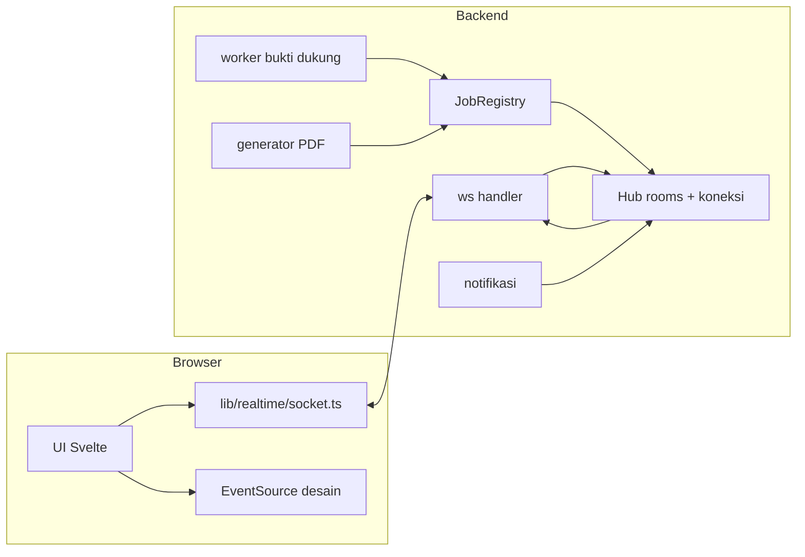

# Rancangan Realtime WebSocket

Dokumen ini merancang penambahan satu kanal WebSocket ke aplikasi Laporan Mingguan PBM
untuk lima kebutuhan, berurutan sesuai prioritas:

1. Progres + pembatalan unduhan bukti dukung (impor).
2. Progres + pembatalan pembuatan PDF.
3. Drag realtime pada editor desain.
4. Notifikasi per pengguna.
5. Monitor sesi untuk admin.

Target deploy: **tanpa Nginx**, aplikasi diakses langsung pada port `4317`.

## Status implementasi

- ✅ **Tahap 0** — kanal `/api/ws`, sinkronisasi layout, kehadiran editor, dan pesan
  `drag`. SSE sudah dihapus.
- ✅ **Tahap 1** — progres dan pembatalan unduhan bukti dukung: `watch_job`/`cancel`
  lewat WebSocket, `GET /imports/jobs`, `POST /imports/{id}/evidence/cancel`, dan UI
  progres + tombol Batalkan/Lanjutkan di halaman Import.
- ✅ **Tahap 2** — progres dan pembatalan PDF: `request_id` pada pembuatan laporan,
  fase `build → queue → render → finalize`, pembatalan menghentikan task dan proses
  Chrome (`kill_on_drop`), berkas sementara dibersihkan lewat guard.
- ✅ **Tahap 3** — hantu drag kolaborator digambar di kanvas (warna per editor,
  kedaluwarsa 4 detik, hanya pada halaman yang sama). Posisi kursor tidak disiarkan.
- ✅ **Tahap 4** — notifikasi per pengguna: tabel `notifications`, siaran ke ruang
  `user:{id}`, badge belum dibaca, daftar di lonceng, pemicu impor/PDF/reset sandi.
- ✅ **Tahap 5** — monitor sesi admin: kolom `user_agent`/`ip`/`last_seen_at`,
  `GET /admin/sessions`, cabut per sesi atau seluruh sesi pengguna, dan
  `session_revoked` yang mengeluarkan perangkat terkait.

---

## 1. Keputusan utama

- **Satu koneksi WebSocket per tab** di `GET /api/ws`, bukan satu kanal per fitur. Semua
  pesan dibedakan lewat `type` dan `room`.
- **Keputusan: opsi B.** Patch layout desain dipindahkan ke kanal WebSocket yang sama
  (bukan SSE terpisah), sehingga simpan dan siaran berada pada urutan yang sama dan satu
  tab hanya memakai satu koneksi panjang. Endpoint `GET /layout` dan `PATCH /layout` tetap
  tersedia sebagai jalur pemulihan dan cadangan simpan.
- **WebSocket bersifat best-effort.** Sumber kebenaran tetap HTTP: setiap keadaan
  (progres job, daftar notifikasi, isi layout) dapat diambil ulang lewat REST saat
  koneksi tersambung kembali. Tidak ada mekanisme replay event yang rumit.
- **Aksi berat tetap HTTP**: unggah Excel, unggah gambar, unduh berkas bukti, unduh PDF.
- **SSE desain sudah digantikan WebSocket** pada tahap 0: endpoint `/design/live`,
  `/design/presence`, dan `/design/presence/leave` dihapus beserta modul `reports::live`.
  Klien memakai `lib/realtime/socket.ts` untuk sinkronisasi layout, kehadiran, dan drag.
- **Autentikasi memakai cookie sesi yang sama** (`laporan_session`), tanpa token baru.
- **Pembatalan bersifat kooperatif**: pekerja berhenti memulai tugas baru, tugas yang
  sedang berjalan diselesaikan (unduhan dibatasi 25 detik), lalu status akhir dilaporkan.

---

## 2. Kondisi saat ini

| Bagian | Berkas | Catatan |
|---|---|---|
| State aplikasi | `backend/src/state.rs` | `AppState` berisi `db`, `config`, `pdf_lock`, `evidence_downloads`, `design_live`, `design_lock`, `shutdown`, `http`. |
| Worker bukti dukung | `backend/src/modules/imports/evidence.rs` | `spawn_import_downloads` → `process_import` (2 putaran) → `expand_drive_folders` + `download_groups` (4 unduhan paralel). Status bukti: `pending`, `ready`, `failed`, `skipped`, `expanded`, `purged`. |
| Lock worker | `state.rs` | `EvidenceDownloadLocks::claim/continue_or_finish/release`, mencegah worker ganda per import. |
| PDF | `backend/src/modules/reports/service.rs` | `generate(db, config, pdf_lock, user_id, period_id)` menulis HTML lalu menjalankan Chrome/Edge headless di bawah `pdf_lock` global. |
| Sesi | `backend/src/modules/auth/service.rs` | Tabel `sessions(token, user_id, expires_at, created_at)`, cookie `laporan_session`. |
| Realtime desain | `backend/src/modules/reports/live.rs` | SSE per periode: `hello`, `patch`, `presence`, `ping`; presence TTL 30 detik. |
| Middleware host | `backend/src/middleware/local_only.rs` | Menolak `Host` yang tidak diizinkan kecuali bind non-loopback dan `LAPORAN_ALLOWED_HOSTS` kosong. |

Belum ada: pelacakan progres pekerjaan, mekanisme pembatalan, kanal per pengguna, dan
registry koneksi.

---

## 3. Arsitektur target



`Hub` menyimpan:

- `rooms: HashMap<RoomId, broadcast::Sender<ServerMessage>>` untuk siaran per ruang.
- `connections: HashMap<ConnId, ConnInfo>` (user, token sesi, daftar room, waktu terakhir
  menerima pesan) untuk monitor admin dan penutupan paksa.
- `user_conns: HashMap<UserId, HashSet<ConnId>>` untuk mengirim notifikasi/revoke.

`JobRegistry` menyimpan pekerjaan yang sedang berjalan:

- `jobs: HashMap<JobId, JobHandle>` dengan `JobKind` (`Import`, `Pdf`), `CancellationToken`,
  fase terakhir, dan `Child` Chrome untuk PDF.
- Snapshot progres dihitung dari database saat klien berlangganan, bukan disimpan
  sebagai sumber kebenaran.

---

## 4. Protokol pesan

Amplop seragam, versi disertakan agar bisa berkembang:

```json
{
  "v": 1,
  "type": "job.progress",
  "room": "import:i-9",
  "id": "s-1024",
  "at": "2026-11-03T12:00:00Z",
  "data": {}
}
```

- `id` hanya wajib untuk pesan yang butuh balasan/ack.
- Semua nilai waktu dalam RFC 3339 UTC.
- Ukuran satu pesan dibatasi 8 KB; `drag` hanya berisi angka dan id.

### Klien → server

| `type` | `data` | Keterangan |
|---|---|---|
| `subscribe` | `{ "rooms": ["period:p1", "import:i-9"] }` | Berlangganan; server membalas `subscribed` + snapshot. |
| `unsubscribe` | `{ "rooms": ["period:p1"] }` | Berhenti berlangganan. |
| `cancel` | `{ "job": "import:i-9" }` | Minta pembatalan pekerjaan. |
| `drag` | `{ "room": "period:p1", "page": 2, "element": "el-3", "phase": "start" | "move" | "end", "x": 41.2, "y": 88.0 }` | Hantu elemen saat digeser. |
| `notifications.read` | `{ "ids": ["n-1", "n-2"] }` | Tandai notifikasi dibaca (atau lewat REST). |
| `ping` | `{}` | Heartbeat aplikasi setiap 20 detik. |

### Server → klien

| `type` | `data` | Keterangan |
|---|---|---|
| `hello` | `{ "user": {...}, "rooms": [...], "server_time": "..." }` | Setelah upgrade berhasil. |
| `subscribed` | `{ "rooms": [...], "snapshots": [...] }` | Balasan `subscribe`, termasuk snapshot. |
| `job.snapshot` | lihat §5.1 | Kondisi pekerjaan saat klien bergabung. |
| `job.progress` | lihat §5.1 | Diperbarui setiap 400 ms atau tiap 10 item. |
| `job.finished` | `{ "job": "...", "status": "done" | "cancelled" | "failed", "summary": {...} }` | Status akhir. |
| `presence` | `{ "editors": [{ "client_id", "username", "page" }] }` | Boleh tetap dari SSE; dikirim juga bila kanal digabung. |
| `drag` | `{ "client_id", "page", "element", "phase", "x", "y" }` | Hantu drag. |
| `notification` | `{ "id", "kind", "title", "body", "url", "level", "created_at" }` | Notifikasi baru. |
| `notification.count` | `{ "unread": 7 }` | Untuk badge. |
| `session.revoked` | `{ "reason": "admin" }` | Sesi dicabut; klien logout paksa. |
| `error` | `{ "code": "forbidden" | "invalid" | "too_large", "message": "..." }` | Kesalahan protokol. |

Otorisasi ruang diperiksa saat `subscribe`:

- `user:{id}` hanya untuk id sendiri.
- `period:{id}` mengikuti aturan peran yang sudah ada (`DataScope`): admin/operator semua
  periode, polres/polda hanya periode aktif yang ter-scope. Untuk drag, wajib
  `require_writer`.
- `import:{id}` mengikuti akses periode pemilik import.
- `admin` hanya untuk peran `admin`.

---

## 5. Fitur 1 — Progres dan pembatalan bukti dukung

### 5.1 Snapshot dan progres

Saat klien `subscribe` ke `import:{id}`, server mengirim:

```json
{
  "type": "job.snapshot",
  "room": "import:i-9",
  "data": {
    "job": "import:i-9",
    "kind": "import",
    "phase": "download",
    "total": 240,
    "done": 96,
    "ready": 88,
    "failed": 6,
    "skipped": 2,
    "pending": 144,
    "current": "https://drive.google.com/file/d/..."
  }
}
```

Sumber angka: `SELECT status, COUNT(*) FROM import_evidence WHERE import_id = ? GROUP BY status`.
Progres tidak disimpan di tabel baru; cukup dihitung (indeks `import_id` sudah ada).

Fase: `queued` → `expand` (folder Drive) → `download` → `purge` → `done`.

### 5.2 Titik sisip pembaruan

- `process_import`: setelah membaca daftar `pending` dan setelah setiap putaran.
- `expand_drive_folders`: sebelum/sesudah tiap folder.
- `download_groups`: setiap satu tugas `download_group` selesai (gabungkan dengan
  penghitung dan kirim paling cepat 400 ms sekali agar tidak membanjiri kanal).
- `purge_after_import`: awal dan akhir.

Implementasi: `JobEmitter` yang menyimpan penghitung terakhir dan hanya mengirim bila
berubah. Penghitung tambahan (`AtomicUsize`) di dalam putaran menghindari query per item.

### 5.3 Pembatalan

- `JobRegistry` membuat `CancellationToken` saat `spawn_import_downloads` dipanggil.
- Pemeriksaan token di: awal setiap putaran, sebelum setiap folder, sebelum setiap
  `download_group` baru, dan sebelum `purge`.
- Unduhan yang sedang berjalan dibiarkan selesai (maksimum 25 detik) lalu tetap ditandai
  `ready`, sehingga hasil yang sudah terunduh tidak terbuang.
- Baris yang belum terunduh **tetap `pending`**. Alasannya: `resume_pending_downloads`
  hanya berjalan saat backend start, jadi tidak akan otomatis melanjut di tengah sesi;
  tombol **Lanjutkan** memakai endpoint `POST /imports/{id}/evidence/retry` yang sudah
  ada (`retry_import` sudah men-spawn worker bila masih ada `pending`).
- Setelah worker berhenti: `job.finished { status: "cancelled", pending: 144 }`.
- REST cadangan (bila WebSocket terputus): `POST /imports/{id}/evidence/cancel`.

### 5.4 UI

Halaman Import: bar progres di kartu import yang sedang berjalan, teks
`96/240 · 6 gagal · 2 dilewati`, tombol **Batalkan** (dengan konfirmasi) dan
**Lanjutkan**. Setelah selesai, ringkasan gagal tetap tersedia dengan tautan ke daftar
bukti yang perlu diunduh ulang.

---

## 6. Fitur 2 — Progres dan pembatalan PDF

### 6.1 Alur

`POST /periods/{id}/reports` tetap sinkron. Klien mengirim `request_id` (UUID) di body;
server memakainya sebagai id pekerjaan untuk siaran progres ke `user:{id}` dan
`period:{id}`. Bila klien tidak mengirim, server membuat sendiri.

Fase: `build` (metrik + HTML), `queue` (menunggu `pdf_lock`), `render` (Chrome),
`finalize` (metadata + catatan DB), `done`.

```json
{ "type": "job.progress", "room": "period:p1",
  "data": { "job": "pdf:req-42", "kind": "pdf", "phase": "render", "percent": 60 } }
```

Progres di dalam Chrome tidak tersedia; `render` dianggap 40–90% dengan indikator waktu
berjalan, bukan angka palsu per halaman. Fase yang bisa dilaporkan akurat: `build`,
`queue`, dan selesai.

### 6.2 Pembatalan

- Pekerjaan PDF berjalan sebagai task tersendiri; `JobHandle` menyimpan `JoinHandle`-nya.
- `cancel` menandai batal lalu `abort` task. Chrome dijalankan dengan `kill_on_drop(true)`,
  sehingga proses ikut dihentikan saat future dilepas.
- Guard `Drop` menghapus `{report_id}.html`, `{report_id}.pdf` parsial, dan folder
  `chrome-{report_id}` bila pekerjaan gagal atau dibatalkan.
- Guard `pdf_lock` dilepas otomatis (RAII) saat fungsi kembali.
- Bila pekerjaan masih di fase `queue` (menunggu lock), flag batal diperiksa sebelum
  render dimulai dan Chrome tidak pernah dijalankan.

---

## 7. Fitur 3 — Drag realtime

### 7.1 Pesan dan pembatasan

- Klien mengirim `drag` paling cepat setiap **50 ms**; posisi kursor tidak disiarkan.
- Server meneruskan ke semua editor lain di `period:{id}` **kecuali pengirim**, tanpa
  menyimpan apa pun dan tanpa menyentuh layout tersimpan.
- Hantu drag kedaluwarsa setelah **3–4 detik** tanpa pembaruan; klien menghapusnya sendiri.
  Tidak perlu TTL di server.
- `phase: "end"` menghapus hantu segera.

### 7.2 Aturan tampilan

- Warna per `client_id` dari hash ke palet yang sudah dipakai (`CHART_PALETTE`).
- Hantu hanya ditampilkan bila `page` sama dengan halaman aktif.
- Hantu drag berupa kotak bergaris putus-putus seukuran elemen aslinya.
- Tidak ada efek pada seleksi lokal, undo, atau autosave.

### 7.3 Hubungan dengan sinkronisasi layout

- Patch layout, kehadiran, dan drag berada di satu koneksi; urutan antar-pesan dijamin TCP.
- Klien mengirim `design.patch` dengan `request_id`; server menerapkan patch ke database lalu
  membalas `design_saved` (revisi + snapshot) dan menyiarkan `design_patch` ke editor lain.
- Bila koneksi belum siap atau balasan tidak datang dalam 8 detik, penyimpanan jatuh ke
  `PATCH /layout` (jalur cadangan). Saat tab ditutup, penyimpanan terakhir tetap memakai
  `PUT /layout` dengan `keepalive`.

---

## 8. Fitur 4 — Notifikasi

### 8.1 Skema

```sql
CREATE TABLE notifications (
    id TEXT PRIMARY KEY NOT NULL,
    user_id TEXT NOT NULL REFERENCES users(id) ON DELETE CASCADE,
    kind TEXT NOT NULL,
    level TEXT NOT NULL DEFAULT 'info',
    title TEXT NOT NULL,
    body TEXT NOT NULL DEFAULT '',
    url TEXT NOT NULL DEFAULT '',
    read_at TEXT,
    created_at TEXT NOT NULL DEFAULT CURRENT_TIMESTAMP
);
CREATE INDEX idx_notifications_user ON notifications(user_id, read_at, created_at DESC);
```

Fan-out dilakukan saat kejadian (bukan tabel broadcast), karena jumlah pengguna kecil.
Pengguna dengan peran `admin` menerima notifikasi admin satu per satu saat dibuat.

### 8.2 Pemicu

| Kejadian | Penerima | Level |
|---|---|---|
| Impor selesai (N baris, M gagal) | pengunggah | `info` / `warn` |
| Unduhan bukti selesai dengan kegagalan | pengunggah | `warn` |
| PDF siap / gagal | pembuat | `info` / `error` |
| Periode baru dibuat | admin & operator | `info` |
| Kata sandi direset admin | pengguna terkait | `warn` |
| Bukti dukung gagal total (401/403 berulang) | admin | `warn` |

### 8.3 REST pendamping

- `GET /notifications?unread=1&limit=50`
- `POST /notifications/read` `{ "ids": [...] }` atau `{ "all": true }`
- Retensi: hapus baris lebih tua dari 90 hari saat startup dan setelah impor selesai.

UI: ikon lonceng dengan badge jumlah belum dibaca, panel daftar, klik menuju `url`.

---

## 9. Fitur 5 — Monitor sesi admin

### 9.1 Perubahan skema

```sql
ALTER TABLE sessions ADD COLUMN user_agent TEXT NOT NULL DEFAULT '';
ALTER TABLE sessions ADD COLUMN ip TEXT NOT NULL DEFAULT '';
ALTER TABLE sessions ADD COLUMN last_seen_at TEXT NOT NULL DEFAULT '';
```

`create_session` menerima `user_agent` dan `ip` dari handler login.
`last_seen_at` diperbarui oleh extractor autentikasi (paling sering sekali per 60 detik).

### 9.2 Endpoint

- `GET /admin/sessions` → daftar sesi aktif beserta status `online` (punya koneksi
  WebSocket) dan `last_seen_at`.
- `POST /admin/sessions/{token}/revoke` → hapus baris sesi, kirim `session.revoked` ke
  `user:{id}`, tutup koneksi WebSocket yang memakai token tersebut.
- `POST /admin/users/{id}/revoke-all` → cabut semua sesi pengguna (dipakai saat
  reset kata sandi).

Efek revoke langsung terasa karena setiap permintaan REST memvalidasi token ke tabel
`sessions`; koneksi WebSocket ditutup lewat registry `token → conn_id`.

---

## 10. Perubahan kode

### 10.1 Backend

```
backend/src/modules/live/
├── mod.rs        # route GET /api/ws, upgrade, loop baca/tulis
├── protocol.rs   # enum ClientMessage, ServerMessage, validasi ukuran
├── hub.rs        # Hub: rooms, connections, user_conns, revoke
└── jobs.rs       # JobRegistry, JobHandle, JobKind, emitter progres
backend/migrations/0014_realtime.sql
```

- `Cargo.toml`: aktifkan fitur `ws` pada `axum`.
- `state.rs`: tambah `hub: Arc<live::Hub>`, `jobs: Arc<live::JobRegistry>`.
- `app.rs`: `.merge(modules::live::routes())` dan middleware yang sudah ada tetap.
- `imports/evidence.rs`: terima `JobEmitter` + `CancellationToken`; panggil emitter pada
  titik di §5.2.
- `imports/handlers.rs`: endpoint `cancel`, teruskan `hub`/`jobs` ke worker.
- `reports/service.rs`: `generate` menerima `request_id` dan emitter; tambahkan
  pembatalan Chrome.
- `reports/handlers.rs`: baca `request_id` dari body; endpoint `POST /reports/{id}/cancel`.
- `notifications/`: modul baru (models, service, handlers) + pemicu pada impor dan PDF.
- `users/handlers.rs`: tambah endpoint revoke sesi.
- `server.rs`: saat `ShutdownSignal` aktif, kirim `Close` ke semua koneksi.

### 10.2 Frontend

```
frontend/src/lib/realtime/
├── socket.ts     # singleton: connect, backoff, subscribe, throttled send, heartbeat
└── stores.svelte.ts  # notifikasi, editorOnline, job progress
```

- `socket.ts`: satu instance per tab; `connect()` dipanggil setelah login; reconnect
  dengan backoff 0.5 → 1 → 2 → 5 → 10 detik (maks), lalu `subscribe` ulang otomatis.
- Saat tab kembali terlihat, koneksi diperiksa dan langganan dikirim ulang.
- `DesignPanel.svelte`: kirim `drag` (throttle), render hantu pengguna lain.
- Halaman Import: pakai store progres; tombol Batalkan/Lanjutkan.
- `DesignPanel` (tombol PDF): tampilkan fase render + tombol Batalkan.
- `AppShell`: lonceng notifikasi.
- Halaman Admin: tabel sesi + tombol cabut.

---

## 11. Deploy langsung pada port 4317 (tanpa Nginx)

- WebSocket memakai origin yang sama: `ws://<host>:4317/api/ws`. Tidak ada konfigurasi
  proxy tambahan.
- **Keamanan**: tanpa TLS, cookie sesi dan seluruh data (termasuk kata sandi saat login)
  berjalan dalam teks biasa. Bila port ini dapat dijangkau dari internet, sangat
  disarankan salah satu dari:
  - akses hanya lewat VPN/WireGuard atau terowongan SSH,
  - pasang Caddy/Nginx sebagai terminator TLS di depannya.
- Setel `LAPORAN_ALLOWED_HOSTS` secara eksplisit bila `LAPORAN_BIND_ADDR` bukan loopback.
  Saat daftar kosong dan bind non-loopback, middleware saat ini mengizinkan semua host.
- Bila nanti memakai Nginx, tambahkan pada blok `location /`:
  `proxy_http_version 1.1; proxy_set_header Upgrade $http_upgrade; proxy_set_header Connection "upgrade";`
  serta `proxy_read_timeout 3600s;`.
- Pastikan `systemd` mengizinkan koneksi panjang (tidak ada batas khusus, tetapi hindari
  `Restart=always` yang memutus semua kanal saat deploy; gunakan graceful shutdown yang
  sudah ada).

---

## 12. Tahapan implementasi

| Tahap | Isi | Hasil yang bisa diuji | Perkiraan |
|---|---|---|---|
| 0 | `live/` (protocol, hub, handler), migrasi desain ke WS, `socket.ts`, reconnect, cadangan `PATCH /layout` | Satu koneksi per tab; patch, kehadiran, dan simpan berjalan lewat WS | 2–3 hari |
| 1 | `JobRegistry`, progres + cancel impor | Bar progres dan tombol Batalkan/Lanjutkan di halaman Import | 1–2 hari |
| 2 | Progres + cancel PDF (Chrome child, cleanup) | Fase render + Batalkan, tidak ada berkas parsial tersisa | 0,5–1 hari |
| 3 | Hantu drag desain | Dua browser saling melihat elemen bergerak | 1–2 hari |
| 4 | Notifikasi (migrasi `0014`, pemicu, lonceng, REST) | Badge belum dibaca, notifikasi impor/PDF | 1 hari |
| 5 | Sesi admin (kolom sesi, registry, revoke) | Daftar sesi online, cabut sesi memutus koneksi | 1 hari |

Setiap tahap berdiri sendiri dan bisa dirilis terpisah. Tahap 0 wajib lebih dulu.

---

## 13. Pengujian

**Unit (Rust)**
- Serde round-trip `ClientMessage`/`ServerMessage`, penolakan pesan > 8 KB.
- `Hub`: subscribe/unsubscribe, pembersihan room kosong, penolakan ruang tanpa hak.
- `JobRegistry`: cancel sebelum mulai, cancel saat berjalan, idempoten.
- Perhitungan snapshot progres dari baris bukti dukung.

**Integrasi (Rust, `tokio-tungstenite`)**
- Login → buka WS → `subscribe` `import:i-9` → terima `job.snapshot` → jalankan worker →
  terima `job.progress` → `cancel` → terima `job.finished {status: "cancelled"}`.
- `session.revoked` menutup socket dan permintaan REST berikutnya 401.
- PDF: `request_id` di body → `job.progress` fase `render` → cancel → tidak ada PDF.

**Manual (dua browser)**
1. Impor dengan ≥ 50 tautan, amati progres dan batalkan di tengah; lanjutkan kembali.
2. Buat PDF, batalkan saat fase render; pastikan berkas parsial tidak tertinggal.
3. Dua editor: lihat hantu drag pada halaman yang sama dan berbeda.
4. Notifikasi muncul tanpa refresh; badge berkurang setelah dibaca.
5. Admin mencabut sesi pengguna lain; tab tersebut langsung logout.
6. Putuskan jaringan 30 detik; setelah tersambung, langganan pulih dan state sesuai REST.

---

## 14. Risiko dan mitigasi

| Risiko | Mitigasi |
|---|---|
| SQLite sibuk saat unduhan + siaran progres | Progres dikirim maksimal 2,5 kali/detik; penghitung di memori, query hanya saat snapshot. |
| Chrome menggantung saat dibatalkan | Terminate → tunggu 3 detik → kill; bersihkan berkas; `pdf_lock` dilepas RAII. |
| Klien lambat membuat antrean menumpuk | `broadcast` berkapasitas kecil (32); bila tertinggal, klien menerima `resync` dan mengambil snapshot REST. |
| Banyak tab menghabiskan koneksi | Satu WS per tab; SSE desain tetap dipakai (2 koneksi/tab). Konsolidasi opsional di tahap lanjutan. |
| Deploy/restart memutus pekerjaan | Graceful shutdown mengirim `Close`; pekerjaan impor tetap tersimpan di DB dan dilanjutkan saat start. |
| Tanpa TLS di port 4317 | Batasi akses lewat VPN/terowongan, atau tambahkan terminator TLS. |
| Pesan drag membanjiri server | Throttle klien 50 ms; server membuang pesan bila antrean penuh. |

---

## 15. Keputusan yang perlu dikonfirmasi

1. **Status setelah impor dibatalkan**: baris yang belum terunduh tetap `pending`
   (rekomendasi, tombol Lanjutkan memakai endpoint retry yang sudah ada) atau ditandai
   `cancelled` dengan status baru?
2. **Desain**: sudah diputuskan memakai satu kanal WebSocket (opsi B).
3. **Notifikasi**: hanya per pengguna, atau juga siaran ke peran (mis. semua admin)?
4. **Cabut sesi admin**: per sesi (token) saja, atau sekaligus tombol “cabut semua sesi”
   pengguna?
